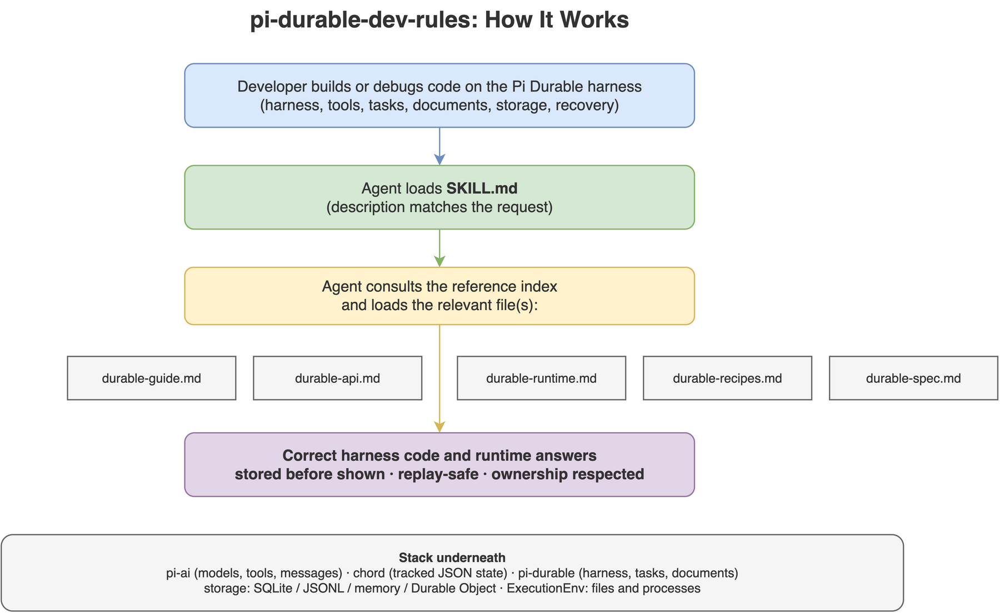

# pi-durable-dev-rules

[](LICENSE)
[](https://github.com/Agents365-ai/365-skills/stargazers)
[](https://github.com/Agents365-ai/365-skills/network/members)
[](https://github.com/Agents365-ai/365-skills/commits/main)

[](https://agentskills.io)

**English** · [中文](README_CN.md)

A coding-agent skill for **building on the Pi Durable agent harness**
(`@earendil-works/pi-durable`). It packages the harness's own guide, its normative Pico5
specification, and the `pi-ai` and `pi-codemode` references together with three hand-written
reference files: the exact public API surface, the runtime semantics, and 19 code recipes drawn from
the package's 32 runnable examples.

Built from a pi checkout at `pi@b9ab2a623` (`pi-durable` 1.2.0, 2026-10-13). The harness API is
experimental: versions move in lockstep with the monorepo and every release may break something, so the
skill states the version it documents and treats a signature difference as a version difference.

For the Pi **CLI** — install, providers, settings, extensions, skills, MCP, the SDK — use the sibling
skill [`pi-dev-rules`](../pi-dev-rules). This skill covers the library layer underneath: harness,
conversations, tools, tasks, documents, storage, environments, code mode, and testing.

Works with Claude Code, Cursor, Codex, Copilot, Windsurf, Cline / Roo Code, Gemini CLI, Aider, Zed,
OpenCode, OpenClaw, and any agent that reads `AGENTS.md` or the
[Agent Skills](https://agentskills.io) format.

<p align="center">
  
</p>

## What's inside

- `SKILL.md`: overview, when-to-use, cheat sheet, hard rules, reference index.
- `references/durable-guide.md`: the package's own guide, verbatim — quick start, concepts, persist and
  resume, extensions, tools (nested calls, `callers`, structured output), code mode, the system prompt,
  the per-conversation agent, settings, the environment, reload, watching, busy conversations, reset
  and handoff, compaction, agent events, hooks, forks, abort and subagents, child tasks, the task
  graph, custom documents, usage, storage, errors, and the example list.
- `references/durable-api.md`: the exact public surface — entry-point map, `Context`, `Harness`,
  `Session`, `Conversation`, `ConversationHandle`, submissions, the `Tx` transaction surface,
  documents, entries, extensions and sections, hooks, tools and `ToolExecutionApi`, tasks and
  `TaskRuntime`, environment, storage, testing, observation, error classes, and the export inventory
  per subpath.
- `references/durable-runtime.md`: how work executes — the commit line and its rules, one input end to
  end, task checkpoints, the ownership tree and structured concurrency, recovery by case, compaction,
  inbox boundaries, live state and progress cadence, the failure model, the knobs that change behavior,
  and the deliberate non-goals.
- `references/durable-recipes.md`: project setup, the catalogue of all 32 examples, and 19 recipes with
  code — minimal chat, persistence and exactly-once input, live UI, agent events, structured-output
  tools, tool-calling tools, foreground and background subagents, child tasks with durable waits,
  coding agent, plan mode, per-conversation sandbox, tool override and wrappers, extension state and
  migration, hooks, compaction, code mode, tool search, conformance testing — plus a pitfall checklist.
- `references/durable-spec.md`: the normative **Pico5 specification**, verbatim (5340 lines): records
  and lifetimes, documents and mutation ownership, transactions and storage ownership, tasks and the
  effect sandwich, structured concurrency, submissions and the inbox, extensions/hooks/tools, the
  built-in tasks, document observation, the storage contract and failure model, the backends, **API
  footguns**, and non-goals.
- `references/pi-ai-models.md`: the model layer, verbatim — `createModels()` / `builtinModels()`,
  provider factories and auth, querying the catalog, defining tools with TypeBox, constrained sampling,
  the event reference, image input, usage and cost, retries, and the message types.
- `references/codemode-sandbox.md`: `@earendil-works/pi-codemode`, verbatim — what a script may call,
  injected globals, the sandbox surface, determinism and memory limits, local versus remote sandboxes.

## Install

| Platform | Path |
| ---------- | ------ |
| Claude Code (global) | `~/.claude/skills/pi-durable-dev-rules/` |
| Claude Code (project) | `.claude/skills/pi-durable-dev-rules/` |
| OpenClaw (global) | `~/.openclaw/skills/pi-durable-dev-rules/` |
| Pi (global) | `~/.pi/agent/skills/pi-durable-dev-rules/` |
| Pi (project) | `.pi/skills/pi-durable-dev-rules/` |

```bash
cp -r pi-durable-dev-rules ~/.claude/skills/      # example: Claude Code, global
```

Or install the whole collection: `npx skills add Agents365-ai/365-skills -g`.

## Updating

Four of the seven reference files are generated: the guide, the Pico5 specification, the `pi-ai`
README, and the `pi-codemode` README come from a pi checkout. The other three
(`durable-api.md`, `durable-runtime.md`, `durable-recipes.md`) are hand-written and must be re-read
against the source on every refresh, because they carry exact signatures and semantics that the
upstream prose does not. Users only need the files as shipped and never have to run anything; rebuilding
is maintainer tooling, documented in [`scripts/README.md`](skills/pi-durable-dev-rules/scripts/README.md).

```bash
bash scripts/refresh.sh /path/to/pi
```

Nothing is fetched over the network: the script reads a local checkout of
<https://github.com/earendil-works/pi>.

## Support

If this project helps you, consider supporting the author:

<table>
  <tr>
    <td align="center">
      
      <br>
      <b>WeChat Pay</b>
    </td>
    <td align="center">
      
      <br>
      <b>Alipay</b>
    </td>
    <td align="center">
      
      <br>
      <b>Buy Me a Coffee</b>
    </td>
    <td align="center">
      
      <br>
      <b>Give a Reward</b>
    </td>
  </tr>
</table>

## Author

**Agents365-ai**

- Bilibili: <https://space.bilibili.com/441831884>
- GitHub: <https://github.com/Agents365-ai>

## License

[MIT](LICENSE)
