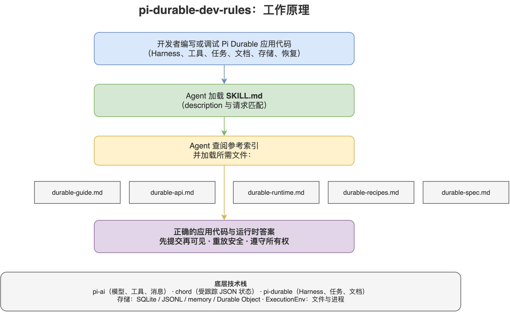

# pi-durable-dev-rules

[](LICENSE)
[](https://github.com/Agents365-ai/365-skills/stargazers)
[](https://github.com/Agents365-ai/365-skills/network/members)
[](https://github.com/Agents365-ai/365-skills/commits/main)

[](https://agentskills.io)

中文 · [English](README.md)

一个用于**在 Pi Durable agent harness（`@earendil-works/pi-durable`）上开发应用**的编程助手技能。
它打包了该 harness 自带的指南、规范性的 Pico5 规格说明，以及 `pi-ai`、`pi-codemode` 的参考文档，
并额外提供三份手写参考：精确的公开 API 表面、运行时语义，以及从该包 32 个可运行示例中提炼的 19 个代码配方。

基于 pi 源码树 `pi@b9ab2a623`（`pi-durable` 1.2.0，2026-10-13）构建。该 harness 的 API 属于实验性质：
版本与 monorepo 同步推进，每个版本都可能带来破坏性变更，因此技能明确标注所记录的版本，
并把签名差异视为版本差异。

面向 Pi **命令行工具**（安装、提供商、设置、扩展、技能、MCP、SDK）的内容请使用姊妹技能
[`pi-dev-rules`](../pi-dev-rules)；本技能覆盖其下的库层：harness、对话、工具、任务、文档、
存储、执行环境、代码模式与测试。

适用于 Claude Code、Cursor、Codex、Copilot、Windsurf、Cline / Roo Code、Gemini CLI、
Aider、Zed、OpenCode、OpenClaw，以及任何支持 `AGENTS.md` 或
[Agent Skills](https://agentskills.io) 格式的工具。

<p align="center">
  
</p>

## 包含内容

- `SKILL.md`：概述、使用时机、速查表、硬性规则、参考索引。
- `references/durable-guide.md`：该包自带指南（原文照录）——快速开始、核心概念、持久化与恢复、
  扩展、工具（嵌套调用、`callers`、结构化输出）、代码模式、系统提示、按对话的 agent、设置、
  执行环境、重载、观察、忙碌会话、重置与交接、压缩、agent 事件、钩子、分叉、中止与子代理、
  子任务、任务图、自定义文档、用量、存储、错误，以及示例清单。
- `references/durable-api.md`：精确的公开表面——入口点对照表、`Context`、`Harness`、`Session`、
  `Conversation`、`ConversationHandle`、提交、`Tx` 事务表面、文档、条目、扩展与提示段、钩子、
  工具与 `ToolExecutionApi`、任务与 `TaskRuntime`、执行环境、存储、测试、观察、错误类，
  以及各子路径的导出清单。
- `references/durable-runtime.md`：执行机理——提交线与相关规则、一次输入的完整流程、任务检查点、
  所有权树与结构化并发、按情形划分的恢复规则、压缩、收件箱边界、实时状态与进度节奏、失败模型、
  会改变行为的配置项，以及有意不提供的功能。
- `references/durable-recipes.md`：项目搭建、全部 32 个示例的目录，以及 19 个带代码的配方——
  最小聊天、持久化与恰好一次输入、实时 UI、agent 事件、结构化输出工具、从工具调用工具、
  前台与后台子代理、带持久等待的子任务、编码 agent、计划模式、按对话沙箱、工具覆盖与包装、
  扩展自有状态与迁移、钩子、压缩、代码模式、工具检索、一致性测试，另附易错点清单。
- `references/durable-spec.md`：规范性的 **Pico5 规格说明**（原文照录，5340 行）：记录与生命周期、
  文档与变更归属、事务与存储归属、任务与 effect sandwich、结构化并发、提交与收件箱、
  扩展/钩子/工具、内建任务、文档观察、存储契约与失败模型、后端、**API 易错点**，以及非目标。
- `references/pi-ai-models.md`：模型层（原文照录）——`createModels()` / `builtinModels()`、
  提供商工厂与认证、模型目录查询、用 TypeBox 定义工具、约束采样、事件参考、图像输入、
  用量与成本、重试，以及消息类型。
- `references/codemode-sandbox.md`：`@earendil-works/pi-codemode`（原文照录）——脚本可调用的内容、
  注入的全局变量、沙箱模块表面、确定性与内存上限，以及本地与远程沙箱的区别。

## 安装

| 平台 | 路径 |
| ---------- | ------ |
| Claude Code（全局） | `~/.claude/skills/pi-durable-dev-rules/` |
| Claude Code（项目） | `.claude/skills/pi-durable-dev-rules/` |
| OpenClaw（全局） | `~/.openclaw/skills/pi-durable-dev-rules/` |
| Pi（全局） | `~/.pi/agent/skills/pi-durable-dev-rules/` |
| Pi（项目） | `.pi/skills/pi-durable-dev-rules/` |

```bash
cp -r pi-durable-dev-rules ~/.claude/skills/      # 示例：Claude Code，全局安装
```

或安装整个合集：`npx skills add Agents365-ai/365-skills -g`。

## 更新

七份参考文件中有四份是生成的：指南、Pico5 规格说明、`pi-ai` README 与 `pi-codemode` README
取自 pi 源码树。另外三份（`durable-api.md`、`durable-runtime.md`、`durable-recipes.md`）为手写，
每次刷新都必须对照源码重新校读，因为它们承载的是上游文档未覆盖的精确签名与语义。
使用者只需使用随技能发布的文件，无需运行任何脚本；重新构建属于维护工具，见
[`scripts/README.md`](skills/pi-durable-dev-rules/scripts/README.md)。

```bash
bash scripts/refresh.sh /path/to/pi
```

脚本不访问网络：它读取本地检出的 <https://github.com/earendil-works/pi>。

## 支持

如果这个项目对你有帮助，欢迎支持作者：

<table>
  <tr>
    <td align="center">
      
      <br>
      <b>微信支付</b>
    </td>
    <td align="center">
      
      <br>
      <b>支付宝</b>
    </td>
    <td align="center">
      
      <br>
      <b>Buy Me a Coffee</b>
    </td>
    <td align="center">
      
      <br>
      <b>打赏</b>
    </td>
  </tr>
</table>

## 作者

**Agents365-ai**

- Bilibili: <https://space.bilibili.com/441831884>
- GitHub: <https://github.com/Agents365-ai>

## 许可证

[MIT](LICENSE)
